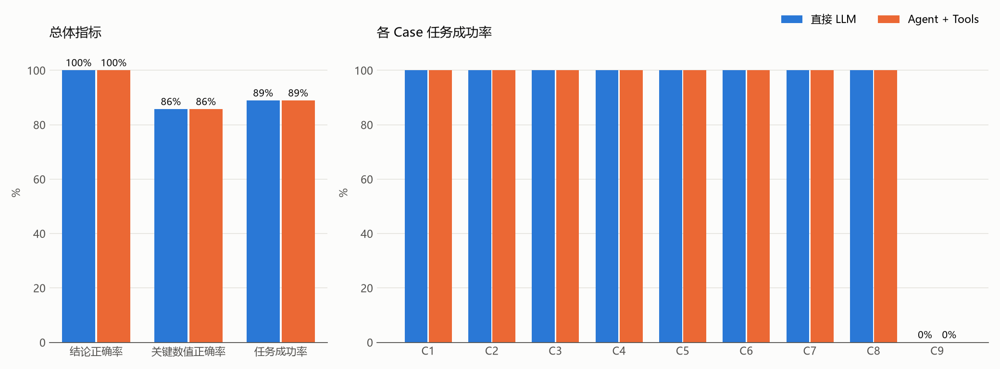

# 校园 Wi-Fi 诊断助手（Wi-Fi Diagnosis Agent）

> 我们希望给**校园网用户和网络管理员**开发一个 AI 小工具，帮助他们解决 **"Wi-Fi 信号看起来不错，但网速很慢/延迟很高"** 的问题。
> 这个工具能够调用 **AP 查询、无线指标查询、有线上联查询、无线容量计算** 4 个工具，获取 **RSSI/SNR、终端数、信道利用率、重传率、上联利用率/RTT/丢包、香农容量与 MCS 估计**，
> 并给出 **区分"信号弱 / 空口拥塞 / 同频干扰 / 上联瓶颈 / 网络侧正常 / 数据不足"的、有证据的诊断结论和下一步建议**。

## 1. 项目功能

- 用户用自然语言描述问题（可以只说地点，如"图书馆三楼网速慢"）。
- Agent（LLM）自主决定调用哪些工具：先定位 AP → 查无线指标 → 定量计算容量与人均带宽 → 必要时检查有线上联。
- 工具只返回**数据和计算结果**，不返回"根本原因"；原因由 Agent 对比至少两个假设后推理得出。
- 统一输出：`Incident / Observations / Possible Causes / Tool Results / Analysis / Conclusion / Recommendation` + `诊断标签`。
- 数据缺失、AP 不存在、参数非法时给出明确说明，不编造数据。
- 附带对照实验脚本：同一模型"直接回答"与"Agent + Tools"在 9 个测试 Case 上自动评测并出图。

## 2. 模型与框架

| 项目 | 说明 |
| --- | --- |
| LLM | 由 `.env` 中的 `LLM_MODEL_ID` 指定（当前为 DeepSeek `deepseek-flash`），通过 `LLM_BASE_URL` 的 OpenAI 兼容接口调用 |
| Agent 实现 | 自己实现的单 Agent 工具调用循环（`src/agent.py`），使用 OpenAI SDK 原生 **function calling**，最多 8 轮 |
| Tool 接口 | `src/tools.py` 中的 Python 函数 + JSON Schema 描述（`TOOL_SCHEMAS`），统一由 `execute_tool()` 调用并捕获异常 |
| 交互方式 | 命令行（`rich` 美化输出），实时显示每一步的工具调用和返回值 |

> 没有使用 PydanticAI/CrewAI：OpenAI 兼容 function calling 足以支撑单 Agent，代码透明、每次工具调用都可记录和复现。

## 3. 目录结构

```text
wifi_diagnosis_agent/
├── README.md
├── requirements.txt
├── .env.example            # 环境变量模板（不含真实 Key）
├── src/
│   ├── main.py             # 命令行入口
│   ├── agent.py            # Agent 循环 + 对照组 DirectLLM + .env 读取
│   ├── tools.py            # 4 个 Tool 的实现与 JSON Schema
│   └── prompts.py          # 系统提示词（专业判据、输出格式由两组共用）
├── data/
│   └── sample_data.json    # 模拟的校园网管监控数据（6 个 AP）
├── tests/
│   ├── test_cases.json     # 9 个测试 Case：输入、期望标签、判断标准、需调用的工具
│   └── run_evaluation.py   # 对照实验 + 自动评分 + 出图
├── results/                # 评测输出（运行后生成）
│   ├── evaluation.csv          # 每一次运行的明细
│   ├── summary_overall.csv     # 两组总体指标
│   ├── summary_per_case.csv    # 各 Case 结果
│   ├── evaluation_chart.png    # 评测图表
│   ├── eval_logs/              # 每次运行的完整回答和工具调用日志
│   └── logs/                   # main.py 交互运行日志
└── docs/
    ├── architecture.png    # 系统架构图
    └── draw_architecture.py
```

## 4. 四个 Tool

| Tool | 功能 | 关键输入 | 返回结果 |
| --- | --- | --- | --- |
| `list_access_points` | 按地点/楼宇/编号查找 AP | `keyword` | AP 编号、位置、在线状态 |
| `get_ap_metrics` | 查询无线侧指标，计算 SNR = RSSI − 底噪 | `ap_id` | 频段、信道、带宽、空间流、RSSI、底噪、SNR、终端数、信道利用率、重传率、同频邻居数、数据完整性 |
| `get_uplink_status` | 查询有线上联，计算两个方向的链路利用率 | `ap_id` | 协商速率、收发流量、利用率、到网关 RTT、丢包率、CRC 错误 |
| `analyze_wireless_capacity` | 无线容量计算 | `bandwidth_mhz`、`snr_db`、`spatial_streams`、`active_clients` | SNR 线性值、香农容量、802.11ax MCS/调制方式/PHY 速率、扣除 MAC 开销后吞吐量、人均带宽 |

用到的专业知识：

- **香农公式** `C = B·log2(1 + SNR_linear)`，`SNR_linear = 10^(SNR_dB/10)`，工具内部完成 dB→线性换算；多空间流按理想 MIMO 估计上限。
- **SNR 与 MCS**：按工程经验 SNR 门限（MCS0 ≈ 5 dB … MCS11 ≈ 38 dB）估计可稳定使用的 802.11ax MCS，查 0.8µs GI 的 PHY 速率表。
- **理论容量 ≠ 实际吞吐**：实际吞吐 ≈ PHY × 0.65（MAC 效率），再由活跃终端共享空口。
- **空口竞争、同频干扰、底噪、重传率、链路利用率、RTT、丢包、CRC 错误**等判据（见 `src/prompts.py` 中 `DOMAIN_KNOWLEDGE`）。

## 5. 环境与安装

- Python 3.10+（开发测试环境：conda 环境 `agent_practise`，Python 3.11）
- 依赖：`openai`、`python-dotenv`、`rich`、`matplotlib`

```bash
pip install -r requirements.txt
```

**配置 LLM**：复制 `.env.example` 为 `.env` 并填写 `LLM_MODEL_ID`、`LLM_API_KEY`、`LLM_BASE_URL`。
若项目目录下没有 `.env`，程序会自动读取上一级目录（`Day4/.env`）。**不要上传含真实 Key 的 `.env`。**

## 6. 运行

交互模式（输入 1/2/3 可直接使用示例问题，q 退出）：

```bash
python src/main.py
```

单次提问：

```bash
python src/main.py -q "图书馆三楼自习区手机 Wi-Fi 信号满格，但下载速度只有 1~2 Mbps，为什么？"
```

对照：同一问题直接问 LLM（不调用工具，原始数据放进提示词）：

```bash
python src/main.py -q "图书馆三楼自习区网速很慢" --baseline
```

## 7. 测试与评测

```bash
python tests/run_evaluation.py               # 9 个 Case × 2 组 × 3 次
python tests/run_evaluation.py --repeat 1 --cases C1 C5   # 只跑部分 Case
```

- **实验 A（直接 LLM）**：同一模型、同样的专业判据和输出格式；把 `sample_data.json` 全部原始数据放进提示词，不能调用工具。
- **实验 B（Agent + Tools）**：同一模型，通过工具查询数据和计算。
- 两组获得的事实数据相同，差别只在于"自己从原始 JSON 里找、自己算" vs "调用工具查、工具算"。

自动评分规则（两组相同）：

| 指标 | 计算方法 |
| --- | --- |
| 结论正确率 | 回答最后的 `诊断标签` 属于该 Case 可接受标签的运行次数 / 总次数 |
| 关键数值正确率 | 回答中出现了正确关键数值（如香农容量 266.3 Mbps，误差 ≤3%），且没有出现编造/擅自修正得到的数值 |
| 任务成功率 | 结论正确 且 关键数值正确 |
| Tool 调用正确率（仅 B） | 必须调用的工具都调用了，且没有调用不该调用的工具（如纯计算题去查 AP） |
| 平均耗时 / 平均工具调用次数 | 每次运行的平均值 |

测试 Case 概览（详见 `tests/test_cases.json`）：

| Case | 类型 | 期望结论 |
| --- | --- | --- |
| C1 | 普通计算：40 MHz、SNR 20 dB | CALC，香农容量 ≈ 266.3 Mbps |
| C2 | 单位陷阱：SNR=30 是线性值 | CALC，≈ 99.1 Mbps（误当 dB 会得 199.3） |
| C3 | 宿舍 512 卡顿（只给地点） | SIGNAL_WEAK |
| C4 | 图书馆信号满格但很慢 | CONTENTION |
| C5 | 教学楼信号好、人少但延迟高 | UPLINK |
| C6 | 实验楼人少但速度不稳 | INTERFERENCE |
| C7 | 食堂刷视频卡 | NORMAL（网络侧正常） |
| C8 | 体育馆 AP 采集超时 | INSUFFICIENT_DATA |
| C9 | 不存在的 AP + 负数带宽 | INVALID_INPUT，且不得输出擅自修正后的容量 |

### 首次评测结果（2026-10-31，deepseek-flash，每组 27 次运行）

| 组别 | 结论正确率 | 关键数值正确率 | 任务成功率 | Tool 调用正确率 | 平均耗时 | 平均工具调用 |
| --- | --- | --- | --- | --- | --- | --- |
| A 直接 LLM | 100% | 86% | 89% | — | 19.3 s | 0 |
| B Agent + Tools | 100% | 86% | 89% | 100% | 15.8 s | 3.2 |



观察（详细回答见 `results/eval_logs/`）：

- 本次所给数据较少（6 个 AP），而且两组拿到的事实数据相同，所以 A 组也能正确完成大部分诊断和计算。在准确率上，**Agent 没有优于直接 LLM**。
- Agent 的优势在可追溯性：每个数值都对应一次可复现的工具调用。另外它不需要把全部数据塞进提示词，平均耗时更短。数据规模变大后，A 组无法一次读入全部数据。
- **C9 两组都失败（0/3）**：两组都判断出了输入无效，但都"好心"地把 −20 MHz 当成 20 MHz 的笔误，并给出了 199.3 Mbps 的容量。Agent 甚至在工具报错后，自己换了参数再调用一次工具。这是典型的"证据不足时擅自补全"，适合在报告中做失败案例分析。
- C7 的 Agent 有 1 次输出 INSUFFICIENT_DATA（可接受标签），其余为 NORMAL，说明 LLM 输出存在随机性。

## 8. 数据说明与已知限制

- `data/sample_data.json` 为**模拟数据**，参照常见校园网 AP 指标设计，不来自真实设备；项目不扫描或操作任何真实网络设备。
- MCS 的 SNR 门限是工程经验近似值，实际还与芯片、信道宽度、终端能力有关；MAC 效率固定取 0.65。
- 多空间流香农容量按理想 MIMO 估算，只是上限。
- 每个 AP 只有一个时间点的快照，无法分析时间趋势（如"晚上才卡"）。
- LLM 输出存在随机性，同一 Case 多次运行结果可能不同，因此评测每个 Case 重复 3 次。
- 诊断标签由 LLM 自己输出，自动评分只检查标签和关键数值，对"分析过程是否合理"仍需人工复核 `results/eval_logs/`。
